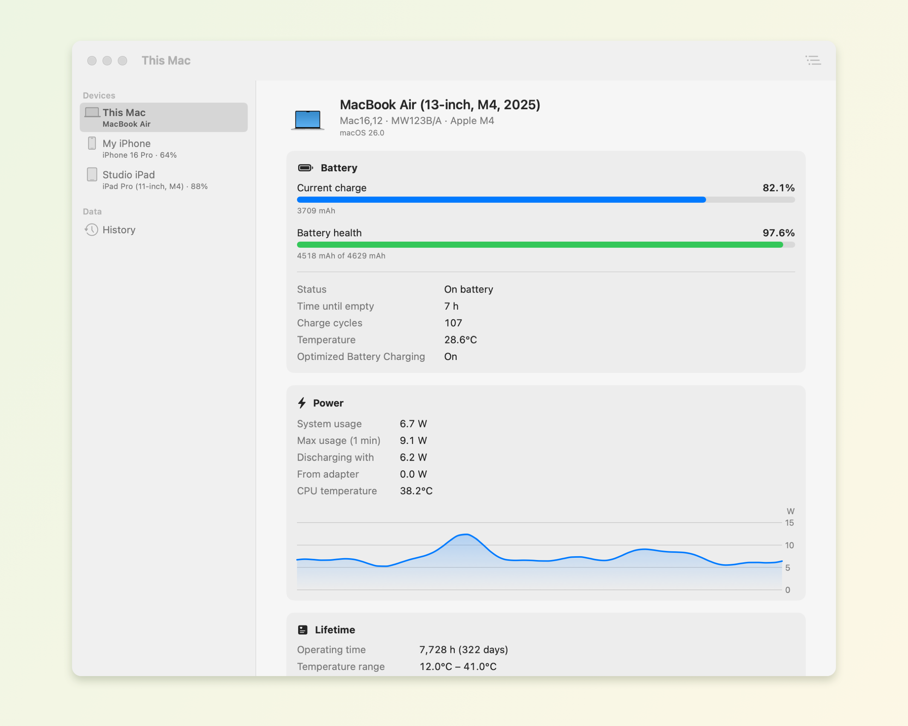
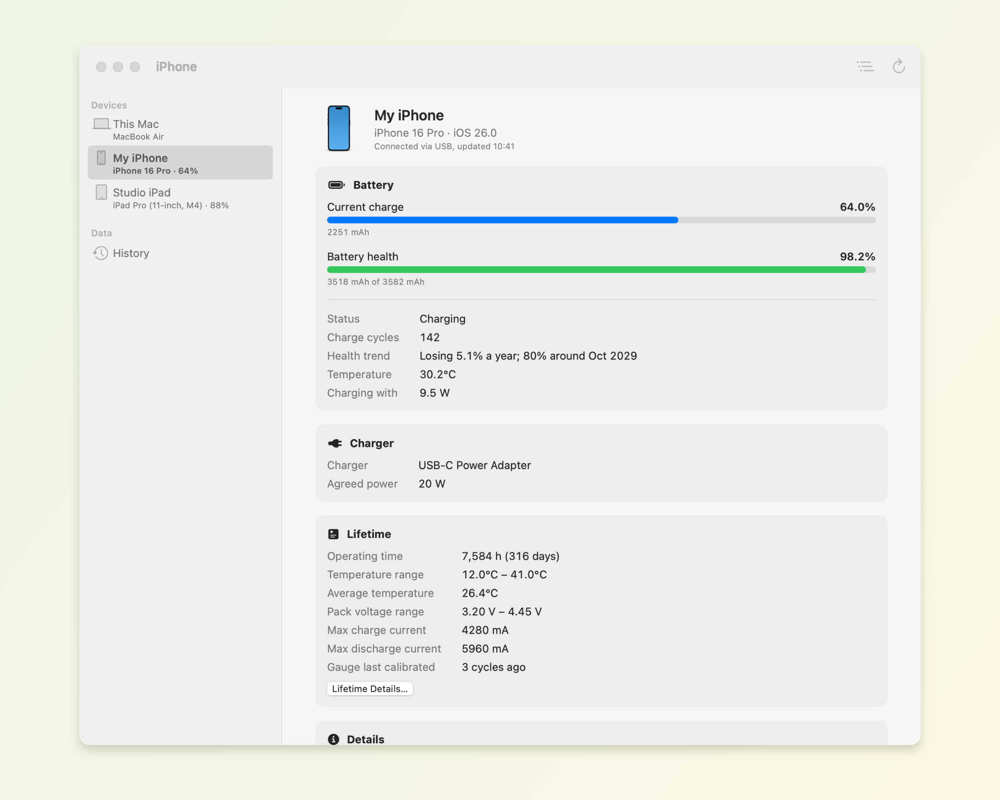
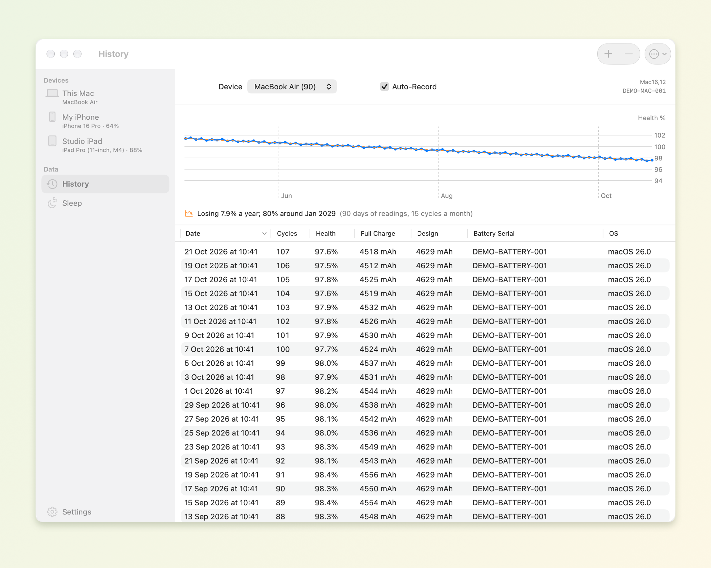
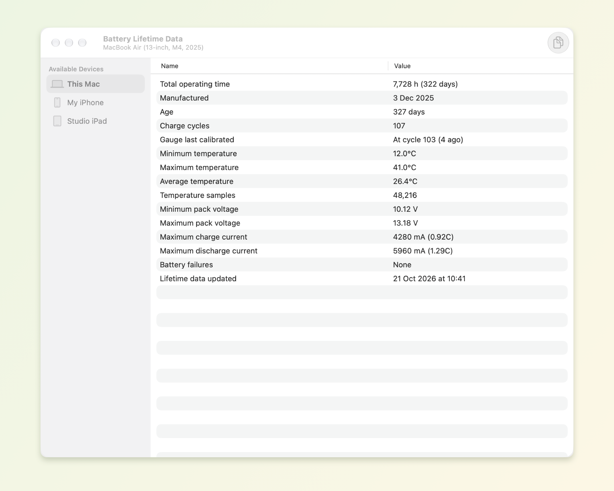
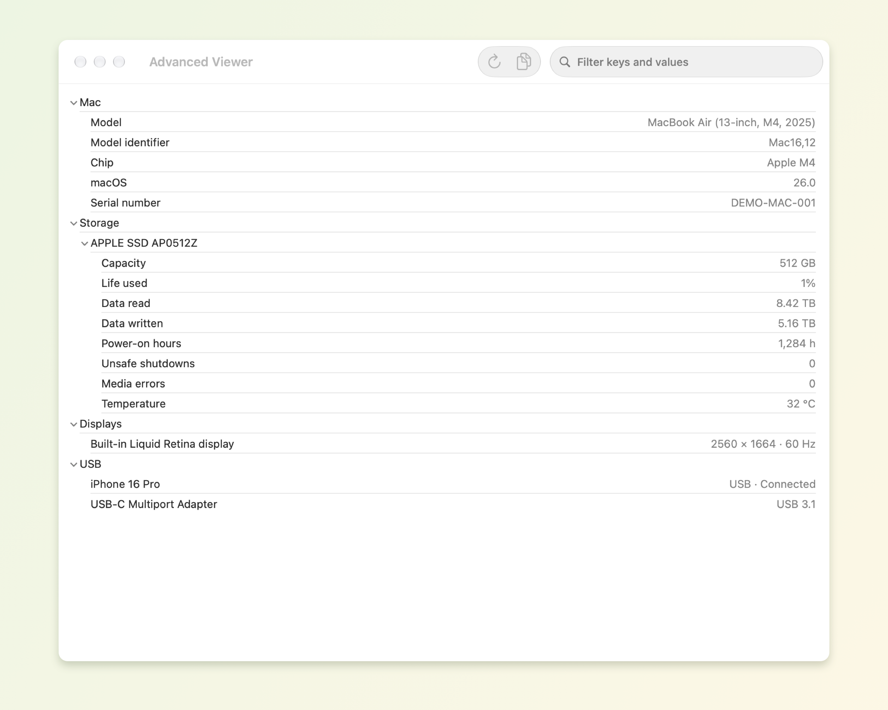

# Citrus Battery

Citrus Battery shows how your Mac's battery is really doing, and your iPhone's and
iPad's too. You get live charge, health, charge cycles, temperature and power draw.
It keeps a history of how capacity changes over time, and records everything the
battery's gauge has logged over its life. It's free, open source, and every feature
is included.

> **Version 1.1.1.** Data availability varies by hardware and OS version.

<p align="center">
  <a href="assets/screenshots/mac-dashboard.png">
    
  </a>
  <br>
  <em>Your Mac's battery, at a glance.</em>
  <br>
  <sub>All screenshots use fictional devices and sample data.</sub>
</p>

## Download and install

Open the [latest GitHub release](https://github.com/rdna897/citrus-battery/releases/latest)
and use the **Download the application** links for **Apple Silicon (M1 or later)**
or **Intel**. You only need one app ZIP; `-sources.zip` files and GitHub's
**Source code** archives are for developers, and `.sha256` files are optional checksums.
The filename states the minimum macOS version for that build. Extract the app ZIP and
drag **Citrus Battery.app** into **Applications**. Homebrew is not needed to run it.

Releases use **ad hoc signing** and are **not notarized by Apple**. If macOS blocks
the first launch, and you trust the release, try opening the app and then use
**System Settings → Privacy & Security → Open Anyway**. See the full
[installation instructions](docs/INSTALL.md) and
[Apple's first-launch guidance](https://support.apple.com/en-gb/102445).
From version 1.1, Citrus Battery can check GitHub for updates. On its second
launch it asks whether to check automatically, and whether to also download and
install updates without asking. Use **Check for Updates…** at any time, or change
these choices in **Settings → Updates**.
Users of version 1.0.1 or earlier need to install 1.1 manually once.

## A closer look

Click any screenshot to see it at full resolution.

<table>
  <tr>
    <td width="50%" align="center" valign="top">
      <a href="assets/screenshots/iphone.png"></a>
      <p><strong>iPhone &amp; iPad</strong><br><sub>Charge, health and battery details over USB or Wi-Fi.</sub></p>
    </td>
    <td width="50%" align="center" valign="top">
      <a href="assets/screenshots/history.png"></a>
      <p><strong>History over time</strong><br><sub>Follow battery health with automatic records and backups.</sub></p>
    </td>
  </tr>
  <tr>
    <td width="50%" align="center" valign="top">
      <a href="assets/screenshots/lifetime.png"></a>
      <p><strong>Battery lifetime</strong><br><sub>Explore operating hours, temperature extremes and calibration.</sub></p>
    </td>
    <td width="50%" align="center" valign="top">
      <a href="assets/screenshots/advanced.png"></a>
      <p><strong>Advanced hardware details</strong><br><sub>Inspect battery data, SSD health, displays and USB devices.</sub></p>
    </td>
  </tr>
</table>

## Features

**Your Mac's battery**
- Charge, health (full-charge capacity ÷ design capacity), charge cycles, temperature,
  voltage, current, time remaining and charger details.
- Battery manufacturer and manufacture date. The date comes from what the battery
  records or from its serial number, or is estimated from its operating hours.
- Power use from the SMC: system usage, its 1-minute peak, adapter input, battery
  charge or discharge rate, CPU temperature, and a live power chart.
- Charge limits: shows macOS's Charge Limit and Optimized Battery Charging, and spots
  third-party charge limiters (AlDente, Battery Toolkit, batt). Where a limit can make
  reported capacity read low, it says so.
- Permanent battery failure flags, decoded.
- A notice when health falls below 80%, with a link to search for a replacement.

**iPhone and iPad**
- Devices connected by USB or on the same Wi-Fi network appear in the sidebar and menu
  bar, with charge, health, cycles, temperature, charger and lifetime data.
- Shows when iOS has paused charging because of Charge Limit or Optimized Battery
  Charging.

**History**
- Auto-Record saves each battery about once an hour when something changes.
- A health chart, a sortable table, JSON backup and restore, and import of
  coconutBattery backups (`.ccba`, which needs coconutBattery installed).

**Battery Lifetime Data**
- Total operating time, age, temperature and pack-voltage extremes, peak charge and
  discharge current (also as a C-rate), the number of temperature samples, the last
  gauge calibration and any battery failures. Available for the Mac and each device.

**Advanced Viewer**
- Every value the battery and device report, as a searchable tree. Also NVMe SSD
  health (life used, data read and written, power-on hours, errors), displays and
  USB devices. Everything can be copied as tab-separated text.

**Menu bar and notifications**
- Status text you can customise with placeholders (`%CHARGE%`, `%CC%`, `%CUSTEMP%`,
  `%HEALTH%`, `%TIMEREM%`, `%STATUS%`, `%SYSWATT%`, `%BATWATT%`, `%CHARGER%`), plus a
  panel showing your Mac and devices. Can open at login, with an optional
  menu-bar-only mode.
- Notifications for low charge, low time remaining, fully charged, and an iPhone/iPad
  reaching a chosen level.

**Settings**
- 8 temperature units, mAh or Wh, raw or macOS-style percentages, and a smoothed or
  fast (1-second) refresh.
- `citrusbattery://` links (`mac`, `history`, `device/<udid>`, `advanced[/<udid>]`,
  `lifetime[/<udid>]`) and command-line output (`--dump`, `--ios`, `--advanced`).

Works on Apple Silicon and Intel Macs.

## Comparison

How Citrus Battery compares with coconutBattery 4.4, free and Plus:

| Feature | Citrus Battery | coconutBattery | coconutBattery Plus |
|---|:-:|:-:|:-:|
| Price | Free | Free | Paid |
| Source code | Open (GPL v3) | Closed | Closed |
| Mac battery: charge, health, cycles, temperature | ✓ | ✓ | ✓ |
| Battery manufacturer and manufacture date | ✓ | ✓ | ✓ |
| Live power use | ✓ | ✓ | ✓ |
| Charge limit detection and advice | ✓ | — | — |
| iPhone/iPad over USB | ✓ | ✓ | ✓ |
| iPhone/iPad over Wi-Fi | ✓ | — | ✓ |
| History with automatic recording, backups | ✓ | ✓ | ✓ |
| Menu bar status | ✓ | ✓ | ✓ |
| Custom menu bar text | ✓ | — | ✓ |
| Notifications | ✓ | — | ✓ |
| Battery Lifetime Data | ✓ | — | ✓ |
| Advanced Viewer (SSD health, displays, USB) | ✓ | — | ✓ |
| Wh units and fast refresh | ✓ | — | ✓ |
| All 8 temperature units | ✓ | 2 | ✓ |
| Printable information sheet | — | ✓ | ✓ (custom templates) |
| Online comparison with other devices | — | ✓ | ✓ |
| Automatic updates | ✓ | ✓ | ✓ |

## Building

Citrus Battery runs on macOS 13 or later. Building requires Swift 6 (Xcode or the
Command Line Tools), Python 3, pkg-config, and librsvg to render the app icon:

```bash
brew install pkgconf librsvg
./scripts/build-dependencies.sh  # libimobiledevice and its libraries, for macOS 13
```

`scripts/build-dependencies.sh` builds libimobiledevice, libplist,
libimobiledevice-glue, libusbmuxd, libtatsu and OpenSSL from pinned, checksummed
source releases into `.build/deps`, targeting macOS 13. `scripts/build-app.sh`
copies them into the app bundle and embeds the pinned Sparkle framework, so the
built app runs on Macs without Homebrew. Sparkle verifies signed update feeds and
downloads before installing them. Without `.build/deps`, the build falls back to
Homebrew's libimobiledevice, which raises the app's minimum macOS to that of the
machine Homebrew built it for.

```bash
swift build                      # debug build
./scripts/build-app.sh           # release build → dist/Citrus Battery.app
./scripts/package-release.sh     # ZIPs, matching sources and checksums
```

Packaging needs a clean, committed checkout. See [releasing](docs/RELEASING.md)
for the GitHub workflow and publishing instructions. The root `VERSION` file is
the source of the app and release version: `1.0`, then `1.0.1` for fixes, `1.1`
for new features, and `2.0` for major compatibility changes.

Command-line helpers:

```bash
.build/debug/CitrusBattery --dump              # print current readings
.build/debug/CitrusBattery --snapshot out.png  # render the main view to an image
```

## Testing

```bash
swift test
```

With only the Command Line Tools installed, Swift Testing's macro plugin isn't on the
default search path, so pass it explicitly:

```bash
swift test -Xswiftc -plugin-path \
  -Xswiftc /Library/Developer/CommandLineTools/usr/lib/swift/host/plugins/testing
```

With a macOS GUI session, test the updater's real signature verification,
installation and relaunch using disposable apps and an ephemeral signing key:

```bash
swift package resolve
python3 scripts/test-updater.py
```

Regenerate the README screenshots on macOS with:

```bash
./scripts/readme-screenshots.sh
```

This renders the actual app views with fictional readings and an in-memory
history database. It does not read connected devices or your saved history, and
the sample-data renderer is excluded from release builds.

## Layout

| Path | Contents |
|---|---|
| `Sources/CSMC` | C shims for the AppleSMC user client and NVMe SMART |
| `Sources/CPowerUI` | Read-only charge limit status from macOS |
| `Sources/CIDevice` | iPhone/iPad access through libimobiledevice |
| `Sources/CitrusKit` | Data layer: battery, power, devices, history, units |
| `Sources/CitrusBattery` | SwiftUI app |
| `Tests/CitrusKitTests` | Unit tests, including fixtures from real Apple Silicon and Intel layouts |

## License

Citrus Battery is free software, licensed under the
[GNU General Public License v3.0](LICENSE).
